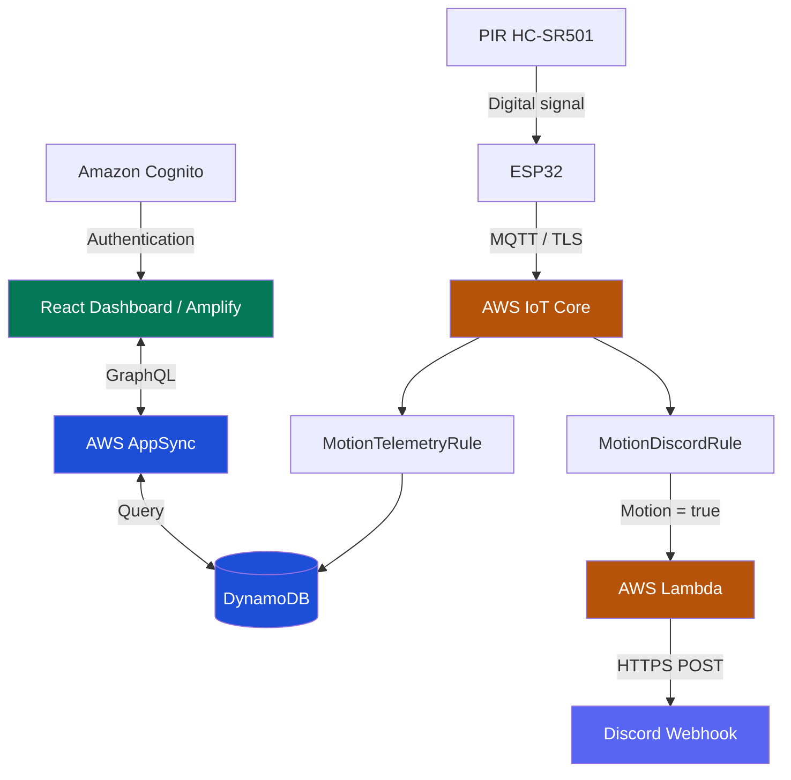
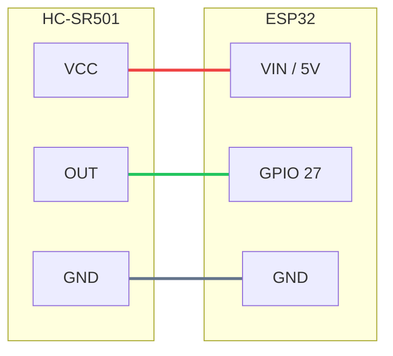

# IoT Motion Monitoring System

## Projektinformation

- **Utbildning:** Mjukvaruutvecklare inom inbyggda system och IoT
- **Skola:** Nackademin
- **Kurs:** IoT och Molntjänster

## 1. Projektbeskrivning

Projektet är ett molnbaserat IoT-system för rörelsedetektering med hjälp av en ESP32 och en PIR-sensor (HC-SR501)

Sensordata skickas till AWS IoT Core via MQTT, lagras i DynamoDB och visualiseras på en webbaserad dashboard.
Vid detekterad rörelse skickas även en automatisk notifikation till Discord.

Syftet med projektet är att demonstrera hur inbyggda system kan integreras med molntjänster för övervakning, datalagring, säker kommunikation och visualisering

## 2. Systemarkitektur



ESP32 kommunicerar direkt med AWS IoT Core via Wi-Fi.
AWS IoT Core fungerar som systemets molnbaserade gateway.
Två separata IoT-regler hanterar datalagring och rörelsenotifikationer

## 3. Hårdvara

| Komponent | Funktion |
|---|---|
| ESP32 Dev Module | Mikrokontroller och Wi-Fi-kommunikation |
| HC-SR501 | PIR-sensor för rörelsedetektering |
| Jumperkablar | Anslutning mellan sensor och ESP32 |
| USB-kabel | Strömförsörjning och programmering |

### Kopplingsschema



| HC-SR501 | ESP32 |
|---|---|
| VCC | VIN (5V) |
| OUT | GPIO 27 |
| GND | GND |


## 4. Teknologier

### Inbyggt system
- C++
- PlatformIO
- Arduino Framework
- PubSubClient
- ArduinoJson
- MQTT
- TLS

### Frontend

- React
- TypeScript
- Vite
- CSS
- AWS Amplify
 
### Molntjänster

| AWS-tjänst | Funktion |
|---|---|
| IoT Core | Kommunikation med ESP32 |
| DynamoDB | Lagring av sensordata |
| Lambda | Hantering av rörelsenotifikationer |
| AppSync | GraphQL API för datahämtning |
| Cognito | Användarautentisering |
| Amplify | Hosting och deployment |
| IAM | Behörighetshantering |

AWS-region: `eu-north-1` (Stockholm)

## 5. Kommunikation och dataformat

ESP32 ansluter till AWS IoT Core med MQTT över TLS på port 8883

**MQTT-topic** `motion-01/telemetry`

Ett JSON-meddelande publiceras vid uppstart, återanslutning och när sensorns tillstånd förändras.

Exempel:

```json
{
  "deviceName": "motion-01",
  "motion": true,
  "timestamp": "1795696088"
}
```

| Fält | Datatyp | Beskrivning |
|---|---|---|
| deviceName | String | Enhetens identifierare |
| motion | Boolean | Registrerat rörelsetillstånd |
| timestamp | String | Unix-tidsstämpel i sekunder |

Tiden synkroniseras med NTP innan ESP32 ansluter 
till AWS IoT Core.

## 6. Datalagring

Sensordata lagras i DynamoDB i tabellen `MotionTelemetry`.

| Attribut | Datatyp | Funktion |
|---|---|---|
| deviceName | String | Partition key |
| timestamp | String | Sort key |
| motion | Boolean | Rörelsestatus |

AWS IoT Core använder följande SQL-regel för att lagra inkommande sensordata:

``` sql
SELECT * FROM 'motion-01/telemetry'
```

## 7. Dashboard

Dashboarden är utvecklad med React och TypeScript och publicerad via AWS Amplify. 

Sensordata hämtas från DynamoDB genom AWS AppSync och uppdateras automatiskt var femte sekund

Dashboarden visar:

- Senast registrerad rörelsestatus.
- Antal registrerade rörelsedetekteringar bland hämtade poster.
- Tidpunkt för senaste rörelsedetektering.
- Aktivitetsgraf.
- Historik över sensorhändelser.

Användaren behöver logga in via Amazon Cognito för att komma åt dashboarden


## 8. Discord-integration

Vid detekterad rörelse aktiveras Lambda-funktionen `MotionDiscordAlert` genom följande IoT-regel:

```sql
SELECT * FROM 'motion-01/telemetry'
WHERE motion = true
```

Lambda skickar en HTTPS POST-förfrågan till Discord via en Webhook. Notifikation innehåller enhetens identifierare samt datum och tid för rörelsedetektering.


## 9. Säkerhet

Systemet använder följande säkerhetsåtgärder:

- MQTT över TLS för krypterad kommunikation.
- X.509-certifikat för autentisering av ESP32.
- AWS IoT Policy för begränsad enhetsbehörighet.
- IAM för behörigheter mellan molntjänster.
- Amazon Cognito för användarautentisering.
- `.gitignore` för att exkludera känsliga uppgifter.
- Miljövariabel för Discord Webhook-adressen.

## 10. Installation

### Firmware

1. Öppna mappen `firmware` i PlatformIO
2. Kopiera `secrets.example.h` till `secrets.h`.
3. Fyll i egna Wi-Fi-uppgifter och AWS-certifikat samt IoT-endpoint.
4. Anslut sensorn enligt kopplingsschemat.
5. Bygg och ladda upp programmet till ESP32

### Molntjänster och frontend

Konfigurera AWS IoT Core, DynamoDB, Lambda och tillhörande IoT-regler enligt systemarkitekturen.

Frontend och tillhörande Amplify-backend finns i repositoryt. En giltig `amplify_outputs.json` krävs för anslutning till AWS-miljön.

## 11. Testresultat

| Test | Resultat |
|---|---|
| Wi-Fi-anslutning | Godkänt |
| Rörelsedetektering | Godkänt |
| MQTT-kommunikation | Godkänt |
| Datalagring i DynamoDB | Godkänt |
| Discord-notifikationer | Godkänt |
| Användarinloggning | Godkänt |
| Visualisering | Godkänt |
| Automatisk uppdatering | Godkänt |

Hela systemet har testats från fysisk rörelsedetektering till visualisering och notifikationer.

## 12. Begränsningar för framtida förbättringar. 

Systemet är en prototyp med ESP32 och PIR-sensor. Dashboarden hämtar maximalt 100 sensorhändelser och visar senast registrerad sensorstatus.

Framtida förbättringar: 

- Stöd för flera IoT-enheter.
- Certifikatrotation.
- Övervakning av enhetens anslutningsstatus.
- Förbättrad felhantering.
- Mer avancerad statistik. 
